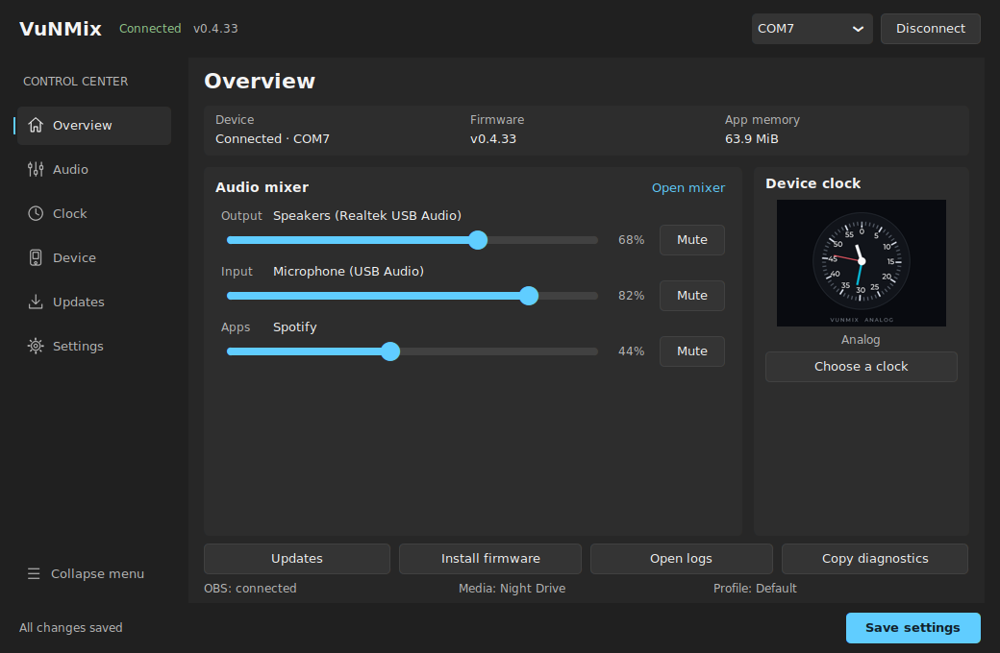
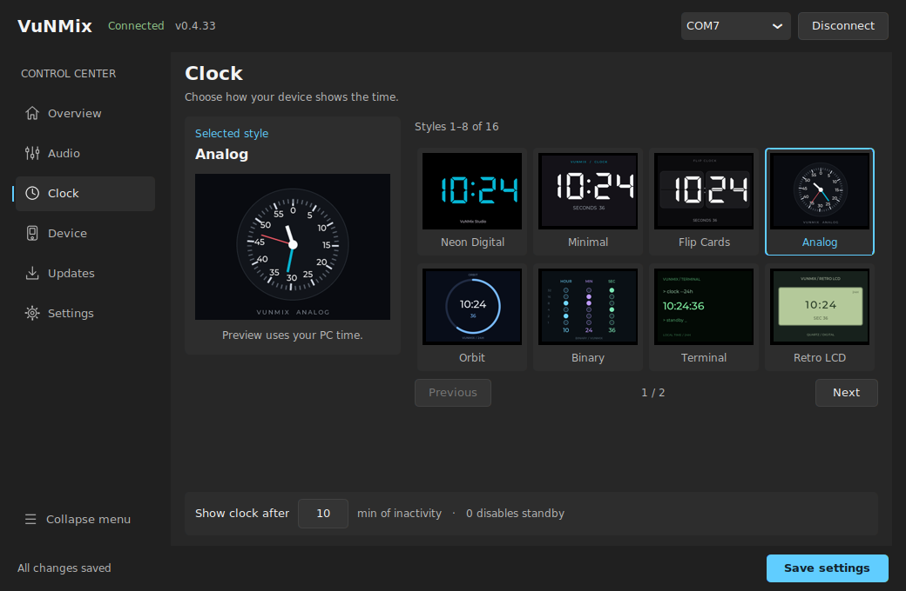

# VuNMix v0.4.33

## Windows dark interface and firmware-matched clock previews

This release updates the Windows Control Center on top of v0.4.32. The previous
gallery represented clock styles with text and symbols, while Overview always
showed a generic digital clock. Small windows also clipped populated Audio and
Updates pages.

## Interface captures

These captures run the actual Tk/CustomTkinter interface with inert test data
and Analog selected. They were captured on Linux with a Segoe UI font fallback;
native Windows uses Segoe UI and its own title bar.





## Changes

### Interface

- Neutral charcoal layers (`#202020`, `#272727`, `#2D2D2D`), readable Segoe UI
  text, restrained cyan accents and consistent neutral controls.
- A single connection header, line icons, a clear navigation indicator and a
  persistent footer. A page stack removes the unused space from the hidden
  tab control.
- Audio controls explicitly label Mute, Unmute and Set default. Four sessions
  per mixer page remain accessible on small windows; Profiles and Media/OBS
  retain their existing service actions.
- Device and Settings use aligned rows with explanations. Updates groups
  software actions, device status and automatic update preferences.
- Window dimensions, sidebar thresholds and image sizing account for CTk's
  Windows DPI scaling. Clock thumbnails adapt to their available space.

### Clock accuracy

- All sixteen existing protocol IDs are retained, from Neon Digital through
  Math Clock. Selecting a style updates the gallery, its large preview and
  Overview together.
- Previews are drawn at the firmware's native **320 × 240** layout, preserving
  the **4:3** aspect ratio. The renderer mirrors the firmware's coordinates,
  palettes, time rules and labels rather than substituting generic glyphs.
- The actual DSEG and LVGL Montserrat bitmap fonts are embedded with their
  metrics and kerning. Their OFL/MIT notices are packaged in
  `desktop/assets/licenses/clock-preview-fonts.txt`.
- Gallery samples use **10:24:36** for comparison. The selected preview uses
  the local PC time and stops ticking while the window is hidden.
- The existing compatibility gate still requires firmware v0.4.21 or newer
  for styles 8–15.

These are local renderings based on the firmware, not screenshots retrieved
from a connected board. Curved and diagonal edges may have minor antialiasing
differences from LVGL; a physical RGB565 panel also quantizes colors.

### Saving and connection behavior

- Save keeps the window open and confirms the save in the footer.
- Editing and reverting a preference correctly updates the unsaved indicator.
- Both timeout fields are validated before configuration is changed.
- An explicitly selected COM port remains visible while discovery or a
  previous connection restart still reports an older port.
- Repeated saves retain the newest COM target. A serialized worker applies
  port changes without dropping a save made during controller shutdown/startup.

### Verification

- Firmware feature contracts preserve all sixteen styles and protocol fields.
- Preview tests compare the actual compiled firmware art draw commands with
  the Python renderer for **40 clock states**. Other tests exercise midnight
  rollover, blinking, binary encoding, bitmap font metrics and aspect ratio.
- Settings regression tests cover invalid inputs, save feedback, dirty-state
  reversion, explicit COM intent and saves arriving during connection restarts.
- The Windows Tk smoke test builds real pages with populated inert services,
  checks widget and image bounds, selects every clock style, and saves without
  hiding the window.
- `desktop/tools/capture_control_center.py` captures the actual GUI and writes
  a geometry/source-hash manifest. It rejects layout errors, callback failures,
  unintended service writes and source changes during a capture.
- The existing release workflow additionally runs the complete Windows suite,
  five connection/crash stress rounds, ESP32-S3 build and packaged Windows tests.

Capture the interface from a source checkout with the desktop dependencies and
a working native Tk display:

```bash
python desktop/tools/capture_control_center.py --output ./ui-captures --connected --all-clock-styles --assert-layout
```

For a scaled layout check, add `--scaling 1.5`. Xvfb captures on Linux use the
host font fallback and do not replace native Windows or physical-board QA.
