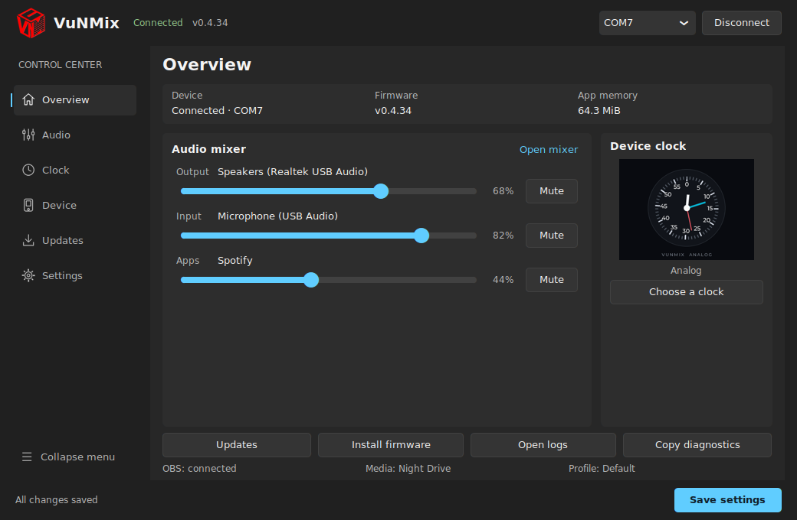

# VuNMix v0.4.34

## Personal logo throughout the Windows application

VuNMix now uses the existing personal artwork in
[`desktop/assets/logo.png`](../desktop/assets/logo.png) consistently. The source
PNG and its original colors/transparency are preserved.



This capture shows the actual interface with inert connected-state test data.
It was captured on Linux with a Segoe UI font fallback; the Windows build uses
native Windows title bars and Segoe UI.

### Changes

- Add the personal logo beside the VuNMix name in the Control Center header.
- Use the same artwork for the main window, Firmware Versions and App Favorites.
  Reapply child-window icons after CustomTkinter's delayed default-icon update.
- Preserve the artwork in the system tray. A small green/gray corner badge shows
  connection state without recoloring the whole logo.
- Resolve source assets relative to the application module, so shortcuts or
  launching from another working directory still find the logo. Frozen builds
  continue using PyInstaller's resource directory.
- Generate the Windows ICO from the PNG at build time, with ten sizes from
  16 to 256 pixels. Use alpha-preserving DIB frames so the older Tk bundled
  with Python 3.11 can select the correct native size instead of upscaling a
  small PNG-compressed frame. The executable, installer, shortcuts and runtime
  windows share this generated icon.
- Verify that the packaged PNG and ICO exactly match the build's source assets
  before creating the portable ZIP and installer.

### Verification

Focused tests cover source/frozen resource paths, aspect ratio, original colors
and alpha, independent image copies, connection badges and all generated ICO
sizes. The real Windows UI smoke test checks the header and main/child-window
icons after CustomTkinter's delayed callback. Existing route, layout, Clock and
Save checks remain in the release workflow, alongside the firmware build and
five connection/crash stress rounds.

Regenerate the source-checkout Windows icon after changing the PNG:

```bash
python desktop/app_branding.py --build-icon
```

PyInstaller performs the same generation automatically before collecting assets.
